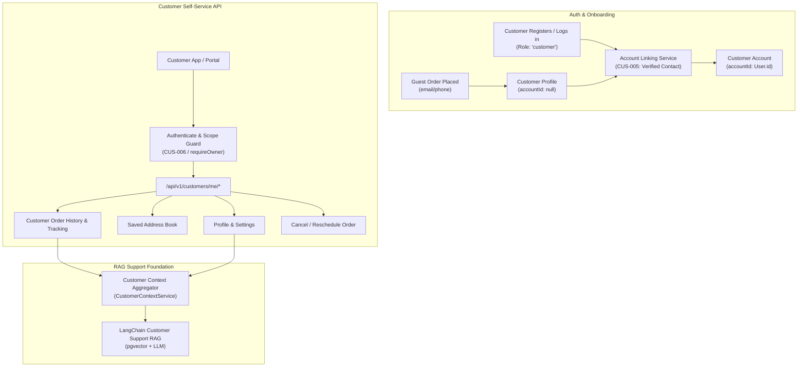

# Deliverix — Customer Lifecycle Implementation Plan

## Goal Description
Implement the complete **Customer Lifecycle** for Deliverix in strict accordance with [Docs/SRS.md](file:///C:/test/Deliverix/Docs/SRS.md) (`CUS-001..006`, `ORD-008..009`, `RSC-001..003`, `PRIV-005`), establishing the end-to-end data models, self-service customer APIs, verified account linking, and customer context aggregation needed for the upcoming **LangChain Customer Support RAG System**.

---

## Architectural Context & System Flow



---

## User Review Required

> [!IMPORTANT]
> **Customer Permissions & Role Alignment**:
> Currently, `prisma/seed.ts` gives the `customer` role only `["orders.view"]`. To support customer self-service safely without giving staff-level `customers.manage` or `customers.view` privileges, we introduce dedicated customer permissions:
> - `customers.me.view`: Access own customer profile & addresses
> - `customers.me.update`: Update own customer profile
> - `customers.me.addresses`: Create/edit/delete own saved addresses
> - `orders.me.cancel`: Cancel own order before pickup
> - `orders.me.reschedule`: Request rescheduling for own order

> [!NOTE]
> **Account Linking Verification (`CUS-005`)**:
> When a registered user attempts to link their account to an existing customer record created during guest checkout, contact ownership is verified by matching the user's verified email and/or phone number.

---

## Proposed Changes

Grouped by component and layer:

---

### 1. Database & Permissions (`prisma/`)

#### [MODIFY] `prisma/seed.ts`
- Update `ROLE_PERMISSIONS.customer` to include:
  `["orders.view", "customers.me.view", "customers.me.update", "customers.me.addresses", "orders.me.cancel", "orders.me.reschedule"]`.
- Ensure permissions are upserted into database during seeding.

---

### 2. Customer Module Domain Layer (`src/modules/customers/`)

#### [MODIFY] `src/modules/customers/customers.schemas.ts`
Add validation schemas for customer self-service and account linking:
```typescript
export const updateMeProfileSchema = z.object({
  name: z.string().min(1).max(200).optional(),
  phone: z.string().max(30).optional().or(z.literal(null)),
});

export const linkAccountSchema = z.object({
  customerId: z.string().cuid().optional(), // optional if matched via email
});

export const customerOrdersQuerySchema = z.object({
  cursor: z.string().optional(),
  pageSize: z.coerce.number().int().min(1).max(100).default(20),
  status: z.string().optional(),
});
```

#### [MODIFY] `src/modules/customers/customers.service.ts`
Add core customer lifecycle methods:
- `getMe(userId: string)`: Retrieves the authenticated user's linked customer record, addresses, active order count, and total order count.
- `updateMe(userId: string, data: { name?: string; phone?: string | null })`: Updates the customer's personal details with phone normalization and audit log.
- `linkAccount(userId: string, userEmail: string, userPhone?: string | null)`: Links an existing customer record to the `User` account (`CUS-005`) with audit entry `customer.account_linked`.
- `listMyAddresses(userId: string)`: Returns active addresses for the linked customer.
- `createMyAddress(userId: string, data: CreateAddressInput)`: Adds an address directly to the user's linked customer profile.
- `updateMyAddress(userId: string, addressId: string, data: UpdateAddressInput)`: Updates address with ownership enforcement (`CUS-006`).
- `deleteMyAddress(userId: string, addressId: string)`: Soft-deletes address with ownership enforcement.

#### [MODIFY] `src/modules/customers/customers.controller.ts`
Implement HTTP handlers:
- `getMe(req, res, next)`
- `updateMe(req, res, next)`
- `linkAccount(req, res, next)`
- `listMyAddresses(req, res, next)`
- `createMyAddress(req, res, next)`
- `updateMyAddress(req, res, next)`
- `deleteMyAddress(req, res, next)`

#### [MODIFY] `src/modules/customers/customers.routes.ts`
Mount self-service routes before parametric `/:id` routes:
```typescript
router.get("/me", authenticate, controller.getMe.bind(controller));
router.patch("/me", authenticate, validate({ body: updateMeProfileSchema }), controller.updateMe.bind(controller));
router.post("/me/link-account", authenticate, controller.linkAccount.bind(controller));

router.get("/me/addresses", authenticate, controller.listMyAddresses.bind(controller));
router.post("/me/addresses", authenticate, validate({ body: createAddressSchema }), controller.createMyAddress.bind(controller));
router.patch("/me/addresses/:addressId", authenticate, validate({ body: updateAddressSchema }), controller.updateMyAddress.bind(controller));
router.delete("/me/addresses/:addressId", authenticate, controller.deleteMyAddress.bind(controller));
```

---

### 3. Customer Order Interactions (`src/modules/orders/`)

#### [MODIFY] `src/modules/orders/orders.routes.ts`
Expose customer-safe order endpoints:
- `GET /api/v1/orders/me`: Customer order list (alias / direct shortcut)
- `POST /api/v1/orders/:id/customer-cancel`: Customer cancellation before pickup (`Pending` / `ReadyForPickup`), recording `CANCELED_BY_CUSTOMER` reason code.

---

### 4. RAG Context Aggregator (`src/modules/customers/customer-context.service.ts`)

#### [NEW] `src/modules/customers/customer-context.service.ts`
A dedicated service to build structured, PII-sanitized customer contexts for LangChain retrieval:
```typescript
export interface CustomerRAGContext {
  customer: {
    id: string;
    name: string;
    email: string | null;
  };
  activeOrders: Array<{
    id: string;
    orderNumber: string;
    status: string;
    pickupAddress: Record<string, unknown>;
    deliveryAddress: Record<string, unknown>;
    promisedWindow: { start: Date | null; end: Date | null };
    latestAttempt?: {
      attemptNumber: number;
      status: string;
      failureReason?: string | null;
    };
    latestTimelineEvent: {
      status: string;
      timestamp: Date;
    };
  }>;
  recentCompletedOrders: Array<{
    orderNumber: string;
    status: string;
    deliveredAt: Date | null;
  }>;
  savedAddresses: Array<{
    label: string | null;
    line1: string;
    city: string;
    isDefault: boolean;
  }>;
}
```
This service will be directly imported by the LangChain RAG pipeline to ground customer support queries without cross-customer leakage.

---

## Verification Plan

### Automated Tests
1. **Customer Self-Service Unit & Integration Tests**:
   - `tests/unit/modules/customers/customer-lifecycle.test.ts`
   - Test `getMe`, `updateMe`, and address CRUD.
   - Test account linking (`linkAccount`) with matching verified email vs unmatching email rejection.
2. **Authorization & Boundary Isolation Tests (`CUS-006`, `PRIV-005`)**:
   - `tests/authorization/customer-boundary.test.ts`
   - Verify Customer A cannot view or edit Customer B's addresses, profile, or orders (HTTP 403 / 404).
   - Verify staff with `customers.manage` can access staff routes while customer users cannot access `/api/v1/customers` (bulk staff list).
3. **End-to-End Customer Lifecycle Test**:
   - `tests/e2e/customer-lifecycle-e2e.test.ts`
   - Flow: User Registration &rarr; Link to Guest Customer Profile &rarr; Add Address &rarr; View Orders & Timeline &rarr; Cancel Pending Order &rarr; Generate RAG Context Profile.

### Test Execution Commands
```bash
npm run typecheck
npm test
```
