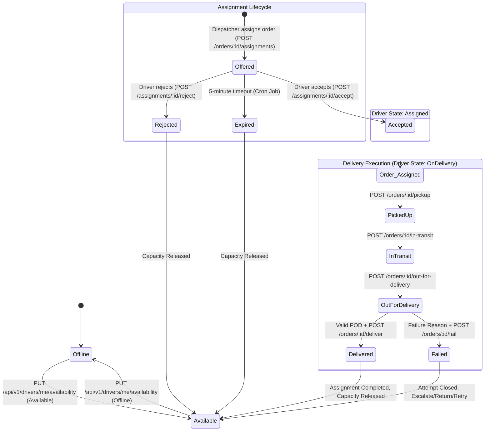
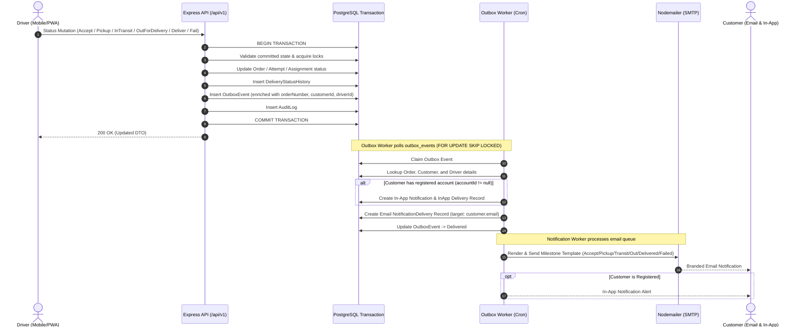

# Driver Journey Implementation Plan

## Goal Description

In Deliverix, the driver is the central physical actor bridging logistics dispatch and customer fulfillment. This plan outlines the complete **Driver Journey Lifecycle** with guaranteed **Dual-Channel Customer Notification** (In-App Notification and Branded Transactional Email) for **every status update executed by a driver**:
1. **Assignment Accepted** (`assignment.accepted`) &rarr; Driver assigned & preparing for pickup.
2. **Order Picked Up** (`order.picked_up`) &rarr; Driver took custody from merchant/origin.
3. **In Transit** (`order.in_transit`) &rarr; Package in active transportation.
4. **Out For Delivery** (`order.out_for_delivery`) &rarr; Driver is in the delivery neighborhood.
5. **Delivered** (`order.delivered`) &rarr; Delivery successfully fulfilled with proof of delivery (POD) receipt.
6. **Delivery Failed** (`order.failed`) &rarr; Attempt failed with reason code and next steps / escalation.

The implementation strictly satisfies all requirements from **Docs/SRS.md (v2.0)** and **AGENTS.md**:
- **TXN-003**: Domain change and outbox events commit atomically in one PostgreSQL transaction.
- **JOB-001..006**: Background workers run via `node-cron` with PostgreSQL row-level lease polling (`FOR UPDATE SKIP LOCKED`).
- **NOT-001..006**: Outbox events reliably produce in-app notifications and email dispatch with exponential retry backoff.
- **BR-004 & WF-001**: Strict state validation against committed database records.
- **ASM-003 & CUS-001..006**: Dual delivery supporting both registered portal users and guest customer profiles.

---

## User Review Required

> [!IMPORTANT]
> **Dual Notification Guarantee for Every Driver Status Update**
> Every driver status mutation commits an atomic outbox event in the same PostgreSQL transaction. When the `outbox-dispatch` background worker processes the event, it guarantees:
> 1. An **In-App Notification** record for registered customer accounts (`customer.accountId != null`).
> 2. A **Transactional Email** via `nodemailerAdapter` dispatched to the customer's email address (`customer.email`) for **all customers** (both registered and guests).

> [!NOTE]
> **Guest / Unlinked Customer Support (SRS ASM-003)**
> Per SRS assumption `ASM-003`, customers may place orders without creating a portal account. For these customers (`customer.accountId == null`), in-app notifications cannot be stored in the database (`Notification.userId` foreign key), but **emails are delivered directly** to the `customer.email` on record at every stage of delivery.

---

## Driver Journey Lifecycle Architecture



### Event & Notification Flow Sequence for Every Driver Action



---

## Detailed Journey Phases & Notifications

| Phase | Driver Endpoint | DB State Transition | Outbox Event | In-App Notification | Customer Email |
| :--- | :--- | :--- | :--- | :--- | :--- |
| **Phase 1: Availability** | `PUT /drivers/me/availability` | `Offline` &harr; `Available` | `driver.state_changed` | Internal / Dispatch | N/A |
| **Phase 2: Accept Offer** | `POST /assignments/:id/accept` | `Offered` &rarr; `Accepted`<br>`ReadyForPickup` &rarr; `Assigned` | `assignment.accepted` | *"Driver assigned to your order"* | **Driver Assigned Email** (Driver details, phone, tracking link) |
| **Phase 3: Pickup** | `POST /orders/:id/pickup` | `Assigned` &rarr; `PickedUp`<br>Driver: `Assigned` &rarr; `OnDelivery` | `order.picked_up` | *"Package picked up"* | **Picked Up Email** (Custody confirmed, estimated delivery) |
| **Phase 4a: In Transit** | `POST /orders/:id/in-transit` | `PickedUp` &rarr; `InTransit` | `order.in_transit` | *"Package in transit"* | **In Transit Email** (Package en route) |
| **Phase 4b: Out for Delivery**| `POST /orders/:id/out-for-delivery` | `InTransit` &rarr; `OutForDelivery` | `order.out_for_delivery`| *"Package out for delivery"*| **Out for Delivery Email** (Driver nearby, be available) |
| **Phase 5: POD Upload** | `POST /orders/:id/proofs` | Proof stored (Cloudinary) | `proof.uploaded` | Internal / Verification | N/A |
| **Phase 6: Delivery Complete**| `POST /orders/:id/deliver` | `OutForDelivery` &rarr; `Delivered`<br>Driver: `OnDelivery` &rarr; `Available` | `order.delivered` | *"Order delivered"* | **Delivery Receipt Email** (Proof summary, delivery timestamp) |
| **Phase 7: Delivery Failed** | `POST /orders/:id/fail` | `OutForDelivery` &rarr; `Failed`<br>Attempt closed | `order.failed` | *"Delivery attempt failed"* | **Attempt Failed Email** (Reason code, rescheduling instructions) |

---

## Proposed Changes

### Component 1: Email Integration & Templates

#### [NEW] `src/integrations/email/templates/driver-accepted.ts`
Branded email template when driver accepts order.
- Informs customer that driver is en route to pick up package.
- Displays driver name, driver code, phone contact, and tracking link.

#### [NEW] `src/integrations/email/templates/order-picked-up.ts`
Branded email template when driver completes pickup.
- Informs customer that driver has taken physical custody of package.
- Displays pickup timestamp, driver details, and tracking link.

#### [NEW] `src/integrations/email/templates/order-in-transit.ts`
Branded email template when package is in transit between pickup and destination.
- Displays live status update and order tracking link.

#### [NEW] `src/integrations/email/templates/order-out-for-delivery.ts`
Branded email template when driver begins the final delivery approach.
- Informs customer that driver is in the immediate vicinity.
- Reminds customer or recipient to be available to receive delivery.

#### [NEW] `src/integrations/email/templates/order-delivered.ts`
Branded email template for delivery confirmation and receipt.
- Displays delivery completion timestamp and recipient confirmation.
- Includes Proof of Delivery (POD) confirmation summary.

#### [NEW] `src/integrations/email/templates/order-failed.ts`
Branded email template when a delivery attempt fails.
- Informs customer of failure reason (e.g. `RECIPIENT_UNAVAILABLE`, `INCORRECT_ADDRESS`).
- Provides support contact and rescheduling instructions.

#### [NEW] `src/integrations/email/templates/index.ts`
Central registry aggregating all templates and providing a typed helper:
```typescript
export function renderDriverStatusEmail(
  eventType: string,
  data: {
    customerName: string;
    orderNumber: string;
    driverName?: string;
    driverCode?: string;
    contactPhone?: string;
    trackingUrl: string;
    reasonCode?: string;
    deliveredAt?: string;
  }
): { subject: string; html: string; text: string } | null;
```

---

### Component 2: Dispatch & Delivery Services (Enriched Outbox Payloads)

#### [MODIFY] `src/modules/dispatch/assignment.service.ts`
In `accept()`, enrich `outboxEvent` payload with complete order, customer, and driver identifiers:
```typescript
await tx.outboxEvent.create({
  data: {
    eventType: "assignment.accepted",
    eventVersion: "1.0",
    aggregateType: "assignment",
    aggregateId: id,
    payload: {
      assignmentId: id,
      orderId: current.orderId,
      driverId: current.driverId,
      orderNumber: order.orderNumber,
      acceptedAt: new Date().toISOString(),
    } as unknown as Prisma.InputJsonValue,
  },
});
```

#### [MODIFY] `src/modules/delivery/delivery.service.ts`
Enrich `outboxEvent` payloads for each driver status change with `orderNumber`, `driverId`, and relevant milestone metadata:
- `pickup()` &rarr; `eventType: "order.picked_up"`, payload: `{ orderId, orderNumber: order.orderNumber, driverId: driver.id, attemptId: attempt.id }`
- `inTransit()` &rarr; `eventType: "order.in_transit"`, payload: `{ orderId, orderNumber: order.orderNumber, driverId: driver.id }`
- `outForDelivery()` &rarr; `eventType: "order.out_for_delivery"`, payload: `{ orderId, orderNumber: order.orderNumber, driverId: driver.id }`
- `deliver()` &rarr; `eventType: "order.delivered"`, payload: `{ orderId, orderNumber: order.orderNumber, driverId: driver.id, attemptId: attempt.id }`
- `fail()` &rarr; `eventType: "order.failed"`, payload: `{ orderId, orderNumber: order.orderNumber, driverId: driver.id, attemptId: attempt.id, reasonCode: data.reasonCode }`

---

### Component 3: Background Jobs & Notification Pipeline

#### [MODIFY] `src/jobs/handlers/outbox-dispatch.ts`
1. **Extend `resolveTarget()`**:
   - Handle both `assignment.accepted` and `order.*` driver lifecycle events.
   - Query order, customer, and driver info to return:
     ```typescript
     interface NotificationTarget {
       userId: string | null;         // customer.accountId (null for guests)
       customerEmail: string | null;  // customer.email
       customerName: string;
       orderId: string;
       orderNumber: string;
       driverInfo?: { driverCode: string; name: string; phone: string };
       type: string;
       title: string;
       message: string;
       payload: Record<string, unknown>;
     }
     ```
2. **Dual-Channel Dispatch in `claim()`**:
   - If `target.userId` is present: create an In-App `Notification` and `NotificationDelivery` (`channel: "InApp"`).
   - If `target.customerEmail` is present: create an Email `NotificationDelivery` (`channel: "Email"`) containing the recipient email and template payload.

#### [MODIFY] `src/jobs/handlers/notification-retry.ts`
1. Resolve email destination:
   - If `notification.userId` is present, look up `user.email`.
   - Fall back to `delivery.recipientEmail` or `notification.payload.customerEmail` for guest customers.
2. Render email content via `renderDriverStatusEmail(notification.type, ...)` so customer receives rich HTML emails instead of plain fallback text.

---

## Verification Plan

### Automated Tests

1. **Email Template Unit Tests**:
   - `tests/unit/integrations/email/driver-status-templates.test.ts`:
     - Test each template (`driver-accepted`, `order-picked-up`, `order-in-transit`, `order-out-for-delivery`, `order-delivered`, `order-failed`).
     - Assert subject, valid HTML markup, and interpolated customer/driver/order details.

2. **Service Outbox Payload Tests**:
   - `tests/unit/modules/dispatch/assignment-accept.test.ts`: Assert `assignment.accepted` outbox payload contains `orderId`, `orderNumber`, `driverId`.
   - `tests/unit/modules/delivery/delivery-outbox-events.test.ts`: Assert `order.picked_up`, `order.in_transit`, `order.out_for_delivery`, `order.delivered`, `order.failed` include required fields.

3. **Outbox & Notification Integration Tests**:
   - `tests/integration/jobs/outbox-driver-notifications.test.ts`:
     - Seed an order with a registered customer: verify both In-App notification and Email delivery records are created.
     - Seed an order with a guest customer (`accountId == null`): verify In-App notification is skipped without error and Email delivery record is successfully created for `customer.email`.
     - Test worker processing through `nodemailerAdapter` mock to verify email delivery.

4. **Concurrency Tests**:
   - `tests/concurrency/assignment-accept-concurrency.test.ts`: Race duplicate accept calls; verify atomic state transition and exactly one set of outbox events emitted.

Command to run test suite:
```bash
npm run test
```

### Manual Verification
1. Log in as Dispatcher/Admin &rarr; create an order for both a registered user and a guest customer.
2. Dispatch & Driver accepts assignment &rarr; verify `assignment.accepted` email received by customer and in-app badge updated.
3. Driver calls `/orders/:id/pickup` &rarr; verify `order.picked_up` email received.
4. Driver calls `/orders/:id/in-transit` &rarr; verify `order.in_transit` email received.
5. Driver calls `/orders/:id/out-for-delivery` &rarr; verify `order.out_for_delivery` email received.
6. Driver completes delivery `/orders/:id/deliver` &rarr; verify final `order.delivered` receipt email received with proof confirmation.
7. Test alternate failure path `/orders/:id/fail` &rarr; verify `order.failed` email with failure reason code received.
